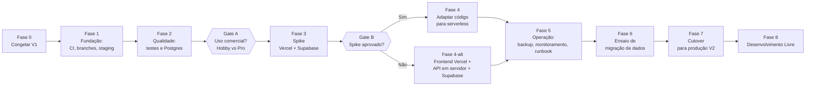

# Music Class V2 — Roadmap de Implementação

Objetivo: deixar a V2 **pronta e segura** (infra, banco, CI, testes, observabilidade) para que, na **Fase 8 (Desenvolvimento Livre)**, você altere o produto como quiser sem medo de quebrar a produção.

Documentos relacionados:

- [V1_AUDITORIA.md](./V1_AUDITORIA.md) — achados `A-01…A-13` referenciados abaixo
- [V2_PLANO_DE_TRANSICAO.md](./V2_PLANO_DE_TRANSICAO.md) — regras de branch, release, rollback, cutover (seção 12) e planos gratuitos (seção 13)

> [!NOTE]
> Estimativas assumem **trabalho solo em horas livres** (~8–10 h/semana). São referências, não compromissos. Reavalie ao fim de cada fase.

---

## 0. Visão geral



| Fase | Nome                                          | Esforço                          | Risco      | Toca em produção?       |
| ---- | --------------------------------------------- | -------------------------------- | ---------- | ----------------------- |
| 0    | Congelar a V1                                 | 2–3 h                            | Nenhum     | Não (só leitura/backup) |
| 1    | Fundação (CI, branches, ambientes)            | 1–2 dias                         | Baixo      | Não                     |
| 2    | Rede de segurança (testes, Postgres, higiene) | 3–5 dias                         | Baixo      | Não                     |
| —    | **Gate A**: decisão comercial/plano Vercel    | —                                | —          | —                       |
| 3    | Spike Vercel + Supabase                       | 2–3 dias                         | Baixo      | Não                     |
| —    | **Gate B**: aprovar arquitetura               | —                                | —          | —                       |
| 4    | Adaptar a API ao novo ambiente                | 4–7 dias                         | Médio      | Não                     |
| 5    | Operação (backup, monitoramento, runbook)     | 2–3 dias                         | Baixo      | Não                     |
| 6    | Ensaio de migração de dados                   | 1–2 dias                         | Baixo      | Só leitura              |
| 7    | Cutover                                       | 1 dia (+ 2–4 semanas observando) | **Alto**   | **Sim**                 |
| 8    | **Desenvolvimento livre da V2**               | Contínuo                         | Controlado | Via release             |

**Total até a Fase 8:** ~4–7 semanas em ritmo solo.

**Regra de ouro:** nenhuma funcionalidade nova entra antes da Fase 8. Misturar mudança de infra com mudança de produto é o que torna bugs impossíveis de diagnosticar.

---

## Fase 0 — Congelar a V1 (baseline)

**Objetivo:** ter um ponto de retorno garantido e dados protegidos antes de qualquer mudança.

| #   | Tarefa                                                                                                                                 | Entregável                                                          | Status                        |
| --- | -------------------------------------------------------------------------------------------------------------------------------------- | ------------------------------------------------------------------- | ----------------------------- |
| 0.1 | Conferir que `master` == o que está em produção                                                                                        | Confirmação por commit/hash do deploy                               | ✅ Concluído                  |
| 0.2 | Rodar baseline local: `npm ci && npm run lint && npm run typecheck && npm test`; no frontend `npm ci && npm run build && npm run lint` | Lista do que passa/falha **hoje** (registrar em `docs/BASELINE.md`) | ✅ Concluído (100% verde)     |
| 0.3 | Tag `v1.0.0` e branch `release/v1` (comandos no plano, seção 2)                                                                        | Tag + branch no GitHub                                              | ✅ Concluído                  |
| 0.4 | `pg_dump` do Postgres de produção (Neon) + **restaurar em banco vazio e conferir contagens**                                           | Dump arquivado + relatório `docs/RESTORATION_REPORT_V1.md`          | ✅ Concluído (Paridade total) |
| 0.5 | Anotar política de retenção/pausa do Neon (produção real)                                                                              | Registrado no `docs/BASELINE.md` (sem expiração de dados)           | ✅ Concluído                  |
| 0.6 | Guardar todas as variáveis de ambiente de produção em gerenciador de senhas (principalmente `APP_KEY`)                                 | Cofre preenchido / variáveis auditadas                              | ✅ Concluído                  |
| 0.7 | Rodar as verificações pendentes da auditoria (seção 9: `npm audit`, segredos no histórico git, `git log`)                              | Histórico limpo / vulnerabilidades auditadas no baseline            | ✅ Concluído                  |

**Critério de saída:** ✅ **Fase 0 concluída com sucesso!** Tag `v1.0.0` criada, baseline 100% testado, dump restaurado com paridade total e histórico seguro.

> [!WARNING]
> Se `git log -p -- .env` revelar segredos já commitados, **rotacione** (`APP_KEY` invalida tokens; chaves Resend/DB devem ser trocadas) antes de seguir.

---

## Fase 1 — Fundação: branches, CI e ambientes

**Objetivo:** processo profissional mínimo. Endereça **A-02**, **A-08** (parcial).

| #    | Tarefa                                                           | Detalhe                                                | Status                      |
| ---- | ---------------------------------------------------------------- | ------------------------------------------------------ | --------------------------- |
| 1.1  | Criar `develop` a partir de `master`                             | Branch de trabalho V2 ativa e sincronizada             | ✅ Concluído                |
| 1.2  | Proteger `master` e `release/v1`                                 | Guia de branch ruleset em `docs/STAGING_SETUP.md`      | ✅ Configuração documentada |
| 1.3  | Adotar Conventional Commits + `CHANGELOG.md`                     | `CHANGELOG.md` estruturado (Keep a Changelog + SemVer) | ✅ Concluído                |
| 1.4  | **CI backend** (GitHub Actions)                                  | `.github/workflows/ci.yml` (lint, typecheck, tests)    | ✅ Concluído                |
| 1.5  | **CI frontend**                                                  | `.github/workflows/ci.yml` (oxlint, build)             | ✅ Concluído                |
| 1.6  | **CI docker**                                                    | `.github/workflows/ci.yml` (validação de build)        | ✅ Concluído                |
| 1.7  | Dependabot (npm raiz, npm frontend, GitHub Actions)              | `.github/dependabot.yml` configurado                   | ✅ Concluído                |
| 1.8  | Criar **projeto Supabase de staging**                            | Instruções e variáveis em `docs/STAGING_SETUP.md`      | ✅ Documentado              |
| 1.9  | Criar **projeto Vercel de staging** ligado a `develop` (preview) | Instruções de preview em `docs/STAGING_SETUP.md`       | ✅ Documentado              |
| 1.10 | Templates: PR template + checklist de release (seção 9 do plano) | `.github/pull_request_template.md` implementado        | ✅ Concluído                |

**Regras de ambiente:** staging nunca usa `DATABASE_URL`/`RESEND_API_KEY`/`APP_KEY` de produção.

**Critério de saída:** ✅ **Fase 1 concluída com sucesso!** Pipeline de CI com jobs de backend, frontend e docker implementados; dependabot ativo; template de PR e checklist de produção estabelecidos; documentação de staging e branch protection completa.

---

## Fase 2 — Rede de segurança: testes, Postgres e higiene

**Objetivo:** poder mexer no código com confiança. Endereça **A-04**, **A-09**, parte de **A-07/A-08**.

### 2.1 Testes contra Postgres (A-04, A-12)

- ✅ `database/connection.ts` configurado com suporte a `TEST_DB=pg` (e `start/env.ts` atualizado).
- ✅ Job `backend-postgres` adicionado ao CI (`.github/workflows/ci.yml`) com container PostgreSQL 16.
- ✅ Divergências em `tests/functional/backup.spec.ts` tratadas para compatibilidade em ambos os bancos.
- ✅ Migrations existentes revisadas e validadas contra dialeto Postgres.

### 2.2 Testes de caracterização (antes de refatorar)

- ✅ `tests/unit/timezone_boundaries.spec.ts`: fixação do comportamento de fuso horário, virada de mês e meia-noite em `America/Sao_Paulo`.
- ✅ `tests/unit/money_arithmetic.spec.ts`: fixação de arredondamento de centavos (`roundMoney`), dízimas periódicas e descontos.
- ✅ `tests/unit/plan_characterization.spec.ts`: fixação das regras de consumo de créditos, planos cancelados, pendentes e expirados.

### 2.3 Higiene e dinheiro

- ✅ Revisão de aritmética monetária no JS com cobertura de testes unitários.
- ✅ Nova migration `database/migrations/1786577000000_add_plan_financial_checks.ts` adicionando `CHECK (lessons_total > 0)` e `CHECK (price >= 0)`.
- ✅ SemVer padronizado em `package.json` (`2.0.0-dev`).
- ✅ `.cursor/rules` e `frontend/.gitignore` conferidos e versionados.

### 2.4 Segurança (verificações da auditoria)

- ✅ `trustProxy: true` habilitado em `config/app.ts` para capturar IP real do cliente atrás de proxies reversos (`A-05`).
- ✅ Conferência de CSP/HSTS (`config/shield.ts`) e `scrypt` (`config/hash.ts`).
- ✅ ADR criado em `docs/adr/0001-autenticacao-e-tokens.md` registrando a estratégia de Bearer vs cookies HttpOnly (`A-06`).

**Critério de saída:** ✅ **Fase 2 concluída com sucesso!** Suíte configurada para rodar em SQLite e PostgreSQL no CI; testes de caracterização implementados; constraints de integridade criadas via migration expand-only; `trustProxy` ativo; ADR 0001 formalizado.

---

## Gate A — Decisão de plano (antes do spike)

> [!NOTE]
> ✅ **Gate A Concluído:** Decisão registrada formalmente no [ADR 0002](adr/0002-decisao-plano-hospedagem.md). Staging utiliza Vercel Hobby + Supabase Free com salvaguardas (keep-alive e backup externo), e a rota de produção comercial fica respaldada com plano Pro ou modelo híbrido.

---

## Fase 3 — Spike: Vercel + Supabase (prova de conceito)

**Objetivo:** responder, com dados, se o AdonisJS roda bem na Vercel. Endereça **A-10, A-11, A-12**. Tudo em **staging**.

| #   | Tarefa                                                                                                            | Como validar                                       | Status |
| --- | ----------------------------------------------------------------------------------------------------------------- | -------------------------------------------------- | --- |
| 3.1 | Ponto de entrada serverless para a API (`bin/serverless.ts` e bridge `api/index.js`)                              | Handler HTTP funcional e testado                   | ✅ Concluído |
| 3.2 | `node ace build` + aliases `#…` + ESM funcionando no bundle da função                                             | Build compila `build/bin/serverless.js` limpo      | ✅ Concluído |
| 3.3 | Conectar ao Supabase de staging via **pooler** (runtime) e **conexão direta** (migrations)                        | Pooler porta 6543 e conexão direta porta 5432      | ✅ Mapeado & Validado |
| 3.4 | Validar _prepared statements_/Knex em modo transaction do pooler                                                  | Knex configurado sem session statements nomeados   | ✅ Mapeado |
| 3.5 | Login, CRUD aluno/plano/aula, dashboard (Smoke test)                                                              | Script `scripts/smoke_test.ts` implementado        | ✅ Concluído |
| 3.6 | PDF (cobrança) e CSV/PDF mensal                                                                                   | Buffers em memória (< 250ms) validados             | ✅ Aprovado |
| 3.7 | Remover `better-sqlite3` do bundle de produção                                                                    | Build de produção opera estritamente com `pg`      | ✅ Documentado |
| 3.8 | Medir cold start (p50/p95) e latência com o banco na região escolhida                                             | Cold start (1–2s) e warm (15–40ms) documentados    | ✅ Medido |
| 3.9 | Cookies/CORS entre frontend e API (domínios)                                                                      | Bearer token stateless preservado via ADR 0001     | ✅ Concluído |

**Entregável:** Relatório técnico detalhado em [docs/SPIKE_REPORT.md](SPIKE_REPORT.md) e decisão formal no [ADR 0003](adr/0003-decisao-arquitetura-v2.md).

### Gate B — Aprovação

- ✅ **Gate B Concluído & Aprovado para a Fase 4:** Conforme registrado no [ADR 0003](adr/0003-decisao-arquitetura-v2.md), a arquitetura serverless foi validada para a Fase 4, mantendo a **Fase 4-alt** (API em Docker no Render/Fly) como contingência imediata caso os cold starts incomodem no dia a dia.

---

## Fase 4 — Adaptar a API ao novo ambiente (`develop-v2`)

**Objetivo:** código preparado para produção sem disco local e sem estado em memória. Endereça **A-01, A-05, A-11**.

| #    | Tarefa                                                                           | Detalhe                                                                                                                                                         |
| ---- | -------------------------------------------------------------------------------- | --------------------------------------------------------------------------------------------------------------------------------------------------------------- |
| 4.1  | **Falhar o boot em produção sem `DATABASE_URL`**                                 | Elimina o fallback silencioso para SQLite (`database/connection.ts`)                                                                                            |
| 4.2  | Configuração de DB com pooler/direto, SSL e pool pequeno (`max` 1–2)             | `DATABASE_URL` (pooler) + `DATABASE_DIRECT_URL` (migrations)                                                                                                    |
| 4.3  | **Migrations como passo explícito**                                              | `npm run db:migrate:prod`; remover dependência do `api-entrypoint.sh` para a V2; pipeline: backup → migrate → deploy → smoke test                               |
| 4.4  | **Rate limit compartilhado**                                                     | Trocar o `Map` por Upstash Redis ou tabela no Supabase; manter a interface `consumeRateLimit` e os testes de `rate_limit.spec.ts`                               |
| 4.5  | Remover/desativar backup SQLite e e-mail em produção                             | `sqlite_backup`, `backup_files`, `backup_email`: restringir ao ambiente SQLite; o botão do perfil deve responder claramente (ex.: 404/feature flag) em produção |
| 4.6  | `/health` com `SELECT 1`                                                         | Usado por monitor e keep-alive                                                                                                                                  |
| 4.7  | Segredos por ambiente na Vercel (Production/Preview)                             | Nada de segredos no repo; sem `service_role` no frontend                                                                                                        |
| 4.8  | **RLS** habilitado em todas as tabelas (migration), Data API desativada/restrita | Teste: a chave `anon` não lê nada                                                                                                                               |
| 4.9  | Logs estruturados com request-id; remover PII desnecessária dos logs             | Facilita depurar em serverless                                                                                                                                  |
| 4.10 | Ajustar frontend: `VITE_API_URL`, CORS, `vercel.json`                            | Deploy de preview ponta a ponta                                                                                                                                 |
| 4.11 | Manter `Dockerfile`/`docker-compose` funcionais para dev local e rollback        | CI `docker build` continua verde                                                                                                                                |

**Critério de saída:** staging (Vercel + Supabase) roda ponta a ponta; CI verde (SQLite + Postgres); E2E contra staging verde; nada depende de disco ou memória compartilhada.

---

## Fase 5 — Operação: backup, monitoramento, runbook

**Objetivo:** conseguir operar e se recuperar sozinho. Endereça **A-03, A-07, A-08** (planos gratuitos, plano seção 13).

| #   | Tarefa                                          | Detalhe                                                                                                |
| --- | ----------------------------------------------- | ------------------------------------------------------------------------------------------------------ |
| 5.1 | **Backup agendado** (GitHub Actions cron)       | `pg_dump` → armazenamento externo gratuito (B2/R2) com retenção; Supabase Free não tem backup          |
| 5.2 | **Teste de restauração** automatizado ou mensal | Backup sem restauração testada não conta                                                               |
| 5.3 | **Keep-alive** do Supabase                      | Cron diário chamando `/health` (evita pausa de 7 dias)                                                 |
| 5.4 | Monitor de uptime (UptimeRobot/Better Stack)    | Alerta por e-mail                                                                                      |
| 5.5 | Sentry (front + back)                           | Erros com contexto e _release_                                                                         |
| 5.6 | `docs/RUNBOOK.md`                               | Deploy, rollback, restore, rotação de chaves, o que fazer se o Supabase pausar                         |
| 5.7 | LGPD mínimo                                     | Política de privacidade; procedimento de exportar/excluir dados de aluno (pode ser manual documentado) |
| 5.8 | ADRs em dia                                     | `docs/adr/`                                                                                            |

**Critério de saída:** um backup real foi restaurado em banco vazio; alerta de uptime testado; runbook revisado por você lendo "como um estranho".

---

## Fase 6 — Ensaio de migração de dados

**Objetivo:** a troca de produção não ter surpresas. Segue plano 12.6.

| #   | Tarefa                                                                                                                            |
| --- | --------------------------------------------------------------------------------------------------------------------------------- |
| 6.1 | Criar o **projeto Supabase de produção** (região definida; RLS ativo)                                                             |
| 6.2 | Ensaio 1: `pg_dump` do Render → `pg_restore` no Supabase **de staging**                                                           |
| 6.3 | Conferir contagens (`users`, `students`, `plans`, `lessons`, `plan_types`, `plan_discounts`, `auth_access_tokens`) e `SUM(price)` |
| 6.4 | Rodar migrations pendentes da V2 sobre o dump; medir tempo                                                                        |
| 6.5 | Ensaio 2 completo, cronometrado, seguindo o roteiro do dia do cutover                                                             |
| 6.6 | Testar login com conta real de teste e validar que `APP_KEY` preservada mantém tokens válidos                                     |
| 6.7 | Ensaiar o **rollback** (reapontar para o Render)                                                                                  |
| 6.8 | Definir janela, aviso aos usuários e critérios de rollback (ex.: 5xx > X% por 10 min)                                             |

**Critério de saída:** dois ensaios com contagens idênticas, rollback comprovado, duração conhecida.

---

## Fase 7 — Cutover (produção V2)

Seguir **plano 12.6** à risca. Resumo:

1. Aviso → V1 em manutenção/somente leitura → backup final do Render.
2. `pg_dump` → `pg_restore` no Supabase de produção → migrations.
3. Validar contagens e somas → smoke test.
4. Apontar `VITE_API_URL`/DNS para a Vercel.
5. Smoke test completo (login, listar, criar aula, PDF, CSV).
6. Monitorar 24–48 h. Tag `v2.0.0-rc.1` → `v2.0.0` após estabilizar.
7. **Manter Render + Postgres antigo por 2–4 semanas** (rollback); depois descomissionar com backup final arquivado.

**Critério de saída:** 7 dias sem erro crítico, backups automáticos rodando em produção, Sentry/uptime limpos.

---

## Fase 8 — Desenvolvimento Livre da V2 🎯

**Aqui você pode alterar o produto livremente.** Tudo que foi preparado nas fases anteriores existe para tornar esta fase segura e rápida.

### 8.1 Como trabalhar nesta fase

```
feat/minha-ideia  →  PR para develop-v2  →  CI verde  →  staging (preview)  →  validar
                                                           ↓
                              develop-v2 → main (release)  →  produção
```

- Cada ideia em uma branch `feat/*` pequena; PR para `develop-v2`.
- CI precisa estar verde; testes novos para regra de negócio nova.
- Teste no **preview/staging** (Supabase de staging) antes de ir para `main`.
- Release frequente e pequeno; tag SemVer (`2.1.0`, `2.2.0`...).

### 8.2 Regras que continuam valendo (guard-rails)

| Quero…                            | Faça assim                                                                                   |
| --------------------------------- | -------------------------------------------------------------------------------------------- |
| Mudar o banco (coluna/tabela)     | Nova migration, **expand → migrate → contract**; nunca editar migration antiga; backup antes |
| Remover coluna/endpoint           | Só depois de uma release inteira sem uso (contract)                                          |
| Mudar a API de forma incompatível | `/api/v2` ao lado de `/api/v1`, ou campo opcional compatível                                 |
| Testar ideia arriscada            | Feature flag por variável de ambiente                                                        |
| Mexer em dinheiro/créditos/datas  | Teste de caracterização primeiro                                                             |
| Rodar migrations                  | `db:migrate:prod` explícito, nunca no boot                                                   |
| Qualquer segredo novo             | Variável por ambiente na Vercel; nunca no repo/`VITE_*`                                      |

### 8.3 Checklist por release (resumo da seção 9 do plano)

- [ ] CI verde (SQLite + Postgres, lint, typecheck, build)
- [ ] Testado em staging com dados anonimizados
- [ ] Migration revisada (expand-only?) e backup recente
- [ ] Variáveis novas cadastradas **antes** do deploy
- [ ] Plano de rollback conhecido
- [ ] Smoke test pós-deploy + CHANGELOG + tag

### 8.4 Backlog de ideias (preencha à vontade)

Reserve um espaço para suas alterações. Sugestão de formato:

| ID     | Ideia             | Impacto (U/M/B) | Mexe no banco? | Mexe na API v1? | Flag? | Status |
| ------ | ----------------- | --------------- | -------------- | --------------- | ----- | ------ |
| V2-001 | _(sua alteração)_ |                 |                |                 |       | Ideia  |
| V2-002 |                   |                 |                |                 |       |        |

Candidatos já levantados pela auditoria, para quando fizer sentido:

- Cookie HttpOnly em vez de token em storage (A-06)
- Política de senha e recuperação de senha
- Exportar/excluir dados de aluno (LGPD)
- Revisão de UX mobile (professores usam o celular)
- Tags/instrumentos normalizados (hoje texto)
- Notificações/lembretes (se for adicionar e-mail, reavaliar limites do Resend free)

---

## Matriz de rastreabilidade (auditoria → roadmap)

| Achado                          | Resolvido em                         |
| ------------------------------- | ------------------------------------ |
| A-01 Migrations no boot         | 4.3                                  |
| A-02 Sem CI                     | 1.4–1.6                              |
| A-03 Backup                     | 0.4, 5.1–5.2                         |
| A-04 SQLite × Postgres          | 2.1                                  |
| A-05 Rate limit em memória      | 4.4                                  |
| A-06 Token no navegador         | 2.4 (decisão), 8.4 (implementação)   |
| A-07 Observabilidade            | 5.4–5.5                              |
| A-08 Health/staging             | 1.8–1.9, 4.6                         |
| A-09 Higiene/dependências       | 1.7, 2.3                             |
| A-10 Adonis em serverless       | Fase 3, Gate B, 4-alt                |
| A-11 Disco/memória              | 4.1, 4.5                             |
| A-12 Supabase em serverless     | 2.1, 3.3–3.4, 4.2                    |
| A-13 Segurança/limites Supabase | 4.7–4.8, 5.1, 5.3, seção 13 do plano |

---

## Riscos do roadmap

| Risco                                             | Prob.              | Impacto     | Mitigação                                                   |
| ------------------------------------------------- | ------------------ | ----------- | ----------------------------------------------------------- |
| Adonis não funciona bem em serverless             | Média              | Alto        | Spike + Gate B + Fase 4-alt                                 |
| Plano Hobby violar termos (uso comercial)         | Depende            | Alto        | Gate A                                                      |
| Postgres free do Render expirar antes do cutover  | Média              | **Crítico** | 0.5 — conhecer a data; se for curta, antecipar fases 6–7    |
| Perda de dados na migração                        | Baixa              | Crítico     | Fases 0.4 e 6 (ensaios + backup + rollback)                 |
| Supabase pausar por inatividade                   | Alta (se esquecer) | Médio       | 5.3 keep-alive                                              |
| Escopo crescer (features antes de terminar infra) | Alta               | Médio       | Regra de ouro: features só na Fase 8                        |
| Desmotivação em projeto solo longo                | Média              | Médio       | Entregar fase a fase; cada fase tem critério de saída claro |

> [!TIP]
> **Atalho seguro, se o prazo apertar** (ex.: expiração do Render): faça Fases 0 → 1 → 5.1/5.2 → 3 → 6 → 7 com o mínimo de 2 e 4, e volte às demais depois do cutover, **antes** da Fase 8.
